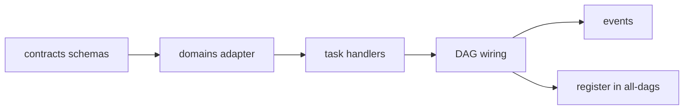

# Hatchet Auditor Flows

The auditor layer has settled structure. Every flow follows the same pipeline:

```
contracts/src/concepts/auditor-*.ts          → Zod data schemas
contracts/src/projections/auditor-*-stage.ts → task-level substructures
contracts/src/workflows/auditor-*-contracts.ts → I/O envelopes
contracts/src/domains/registery.ts             → register all schemas
hatchet/src/domains/auditor/*.ts               → pure domain atoms
hatchet/src/tasks/task-auditor-*-*.ts          → defineTask() handlers
hatchet/src/workflows/dag-auditor-*.ts          → defineDag() wiring
hatchet/src/events/auditor-*.ts                → CloudEvent definitions
hatchet/src/events/types.ts                    → type constants
hatchet/src/workflows/all-dags.ts              → register DAG
```

## Gotchas

- **Domain atoms never import across packages.** A `domains/auditor/` file must not import
  from `@analygo/audit-engine` or any other package. Side effects (browser launch, DB reads,
  LLM calls) are **injected as callback parameters**. The default init imports the engine
  dynamically — the domain fn itself stays pure.

- **Domain types must not end with Schema/Input/Output/Result.** The `check:contracts` gate
  treats any export named `*Schema`, `*Input`, `*Output` etc. in a task/flow file as a
  violation unless it comes from `@analygo/contracts`. Domain companion types must use
  different suffixes: `LaunchBrowserParams`, `BrowserSessionHandle`, not `BrowserLaunchInput`,
  `SessionLaunchResult`.

- **Task output must use registered primitives.** Every field in `defineTask({ output })` must
  be a Zod schema registered in `contracts/src/domains/registery.ts`. You cannot use
  `{} as any` or `z.record(z.string(), z.unknown())`. If a task produces unstructured data,
  declare `output: {}` and pass data through the DAG's emit hook.

- **Assemble task is the aggregation point.** The 371-field `AuditorRunDetailSchema` is the
  assembly target — only the final assemble task produces it. No individual task should
  produce or reference the full run detail. Task-level substructures (`SessionLaunchResult`,
  `CollectedEvidence`, `FindingSet`) live in `projections/auditor-*-stage.ts`.

- **`adopt` is required when `output` is declared.** Every `defineTask` with an `output` field
  must include `adapt: (raw) => raw` (or a real adapter). The template rejects output schemas
  without an adapter fn.

- **Task name prefix must match kind.** `task-C-` for context roots (event readers), `task-`
  for regular steps. The `check:task-event-read` gate rejects a non-root task reading event.

## Procedures

### 1. Add a new auditor flow (e.g. GTM audit)



1. **Schemas** — If the flow needs new concepts (e.g. GTM-specific types beyond
   `ContainerStateSchema` and `AuditTargetsResponseSchema`), add them to
   `contracts/src/concepts/auditor-gtm.ts` or `projections/auditor-gtm-stage.ts`.
   Register every new schema in `registery.ts` and export from barrel files.

2. **Workflow contract** — Create `contracts/src/workflows/auditor-gtm-contracts.ts` with
   input/output envelopes composed from registered primitives. Export from the workflows
   barrel.

3. **Domain atom** — Create `hatchet/src/domains/auditor/gtm-audit.ts` + `-types.ts`. The
   function signature takes typed params and an injected side-effect callback. Callbacks
   default to importing from `@analygo/audit-engine` dynamically. Types file uses suffixes
   that don't end in Schema/Input/Output.

4. **Tasks** — One `defineTask()` per pipeline step. Root task uses `withEvent: "external"`.
   Parented tasks declare `upstream` contracts and read from `upstream.<key>`. Every return
   path has `task: signal("ok"|"partial", "reason")`.

5. **DAG** — `defineDag()` wires tasks: root gets no parents, children declare `parents` +
   `parentsMap`. The DAG wiring file also defines the topology comment (ASCII diagram), the
   `emit` hook (validates through the event definition's `.parse()`), and the `onFailure` hook.

6. **Events** — Add type constant to `events/types.ts`. Create `events/auditor-*.ts` with
   `defineCloudEvent()` calls. Export from events barrel if one exists.

7. **Register** — Add the DAG to `workflows/all-dags.ts`.

### 2. Wire a domain atom (inject side-effects)

Domain atoms are pure — the side-effect boundary is the injected callback:

```ts
// domains/auditor/browser-launch.ts
import type { LaunchBrowserParams, BrowserSessionHandle } from "./browser-launch-types.js";

export async function launchBrowserSession(
  input: LaunchBrowserParams,
  initFn: (runId: string, userSub: string, auditMode: "full" | "consent", siteUrl?: string) =>
    Promise<Record<string, unknown>>,
): Promise<BrowserSessionHandle> {
  const ctx = await initFn(input.runId, input.userSub, input.auditMode, input.siteUrl);
  return {
    browserId: `browser-${input.runId}-${Date.now()}`,
    pageUrl: (ctx.siteUrl as string) ?? input.siteUrl,
    startedAt: new Date().toISOString(),
  };
}
```

The task handler passes the real side-effect:

```ts
execute: async ({ event, log }) => {
  const input = BrowserAuditInputSchema.parse(event);
  const session = await launchBrowserSession(input, mockInitFn);
  //                           inject callback ~~~~~~~~~~
  return { session, task: signal("ok", `launched ${input.siteUrl}`) };
};
```

### 3. Fix the 371-field AuditRunDetailSchema (eventual)

The `AuditorRunDetailSchema` in `projections/auditor-run-detail.ts` is a monolith with three
payload families baked in: run identity (~18 fields), detail/result (~30 fields), and
infrastructure/retry (~20 fields). When adding fields, consider whether they belong in a new
task-level substructure in `projections/auditor-browser-stage.ts` instead. The assemble task
builds the monolith from substructures — new data goes into a substructure first.

## Scripts

None yet. A future `scripts/validate-flow.ts` could check that every DAG's domain atoms,
tasks, events, and contracts are complete and registered.

## References

- [Auditor run detail schema](references/auditor-run-detail.md) — full field reference for the
  371-field monolith. Load this when adding or debugging fields in AuditorRunDetail or
  RunResultV2Schema.

## Existing flows (reference)

| DAG | Tasks | Status |
|---|---|---|
| `dag-auditor-browser` | launch → collect → classify → assemble | ✅ Skeleton (stubs) |
| `dag-auditor-gtm` | ╴ | ❌ Not built |
| `dag-auditor-run` | ╴ (event-root orchestrator) | ❌ Not built |
| `dag-auditor-health` | ╴ (dashboard query) | ❌ Not built |
| `dag-auditor-usage` | ╴ (usage aggregation) | ❌ Not built |